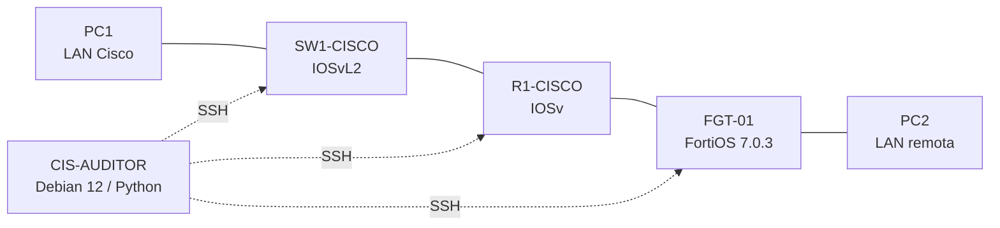

# CIS Hardening — Router, Switch y Firewall

**Video demostrativo:** pendiente de añadir al completar la grabación.

**Estudiante:** Elian Sterling Severino Mejía  
**Matrícula:** 2025-1331  
**Asignatura:** Seguridad de Redes  
**Fecha del laboratorio:** 12 de noviembre de 2026

## Propósito

Implementar y evaluar medidas de endurecimiento de seguridad en una infraestructura virtual de **GNS3 + Proxmox** integrada por un router Cisco IOSv, un switch Cisco IOSvL2 y un firewall FortiGate.

La metodología incluye recopilación de configuraciones por SSH, auditoría inicial de controles seleccionados, aplicación automatizada bajo autorización, verificación posterior e informes comparativos.

## Topología

| Componente | Gestión en el laboratorio |
|---|---|
| R1-CISCO | `10.25.13.1` |
| SW1-CISCO | `10.25.13.2` |
| FGT-01 | `192.168.1.123` |
| CIS-AUDITOR (CT 180) | `10.25.13.220` |
| LAN Cisco | `10.25.13.0/24` |
| Enlace R1 ↔ FGT | `172.31.13.0/30` |
| LAN remota | `10.25.14.0/24` |

## Resultados documentados

El evaluador inicial consideró **19 comprobaciones seleccionadas**: **13 CUMPLE, 2 NO CUMPLE y 4 RIESGO**. Después del hardening de SW1, sobre esas mismas 19 comprobaciones se obtuvo **15 CUMPLE, 0 NO CUMPLE y 4 RIESGO**.

Los cambios de R1 y FGT-01 se verificaron en reportes adicionales, independientes de esa matriz de 19 comprobaciones.

| Equipo | Cambios automatizados |
|---|---|
| SW1-CISCO | Desactivación de HTTP y HTTPS administrativos; SSH v2 conservado |
| R1-CISCO | Desactivación de Proxy ARP e ICMP Redirects en Gi0/0 y Gi0/1; desactivación explícita de IP Source Routing |
| FGT-01 | Telnet administrativo deshabilitado; duración de bloqueo administrativo de 60 a 300 s; tiempo de autenticación SSH de 120 a 30 s |

Las verificaciones posteriores confirmaron que los tres puertos SSH seguían accesibles. También se validó la comunicación entre PC1 y PC2 tras los cambios.

## Estructura

- `scripts/`: recopilación, evaluación, aplicación y verificación de controles
- `reportes/`: informes generados en el laboratorio, previa revisión y sanitización
- `docs/`: topología, metodología, controles y limitaciones
- `evidencias/`: capturas de las pruebas y del proceso
- `configuraciones/`: extractos sanitizados de las configuraciones finales de R1, SW1 y FGT-01 (no son respaldos restaurables)
- `.gitignore`: exclusión de respaldos, credenciales y archivos sensibles

## Evidencias y configuraciones finales

- [Galería de 21 capturas e índice de evidencias](evidencias/INDICE.md)
- [R1-CISCO — extracto sanitizado](configuraciones/R1-CISCO-running-config-sanitizado.txt)
- [SW1-CISCO — extracto sanitizado](configuraciones/SW1-CISCO-running-config-sanitizado.txt)
- [FGT-01 — extracto sanitizado](configuraciones/FGT-01-config-sanitizada.txt)

Los tres extractos se generaron tras una auditoría de solo lectura de **15/15 evidencias** (cinco por dispositivo). Los respaldos originales permanecen privados en CIS-AUDITOR. La sanitización se basa en una selección cerrada de comandos y campos autorizados.

## Reproducibilidad

El auditor se ejecutó en Debian 12 con Python, Netmiko y Paramiko. Los dispositivos Cisco del laboratorio requieren compatibilidad con algoritmos SSH heredados. Las direcciones, versiones y usuarios de los scripts corresponden **exclusivamente al entorno de demostración** y deben adaptarse antes de ejecutarlos en otra infraestructura.

**No ejecutar los scripts de aplicación en producción sin revisión, respaldos, autorización y plan de reversión.**

## Alcance y límites

Este proyecto documenta **controles seleccionados y prácticas de hardening**, no una auditoría integral ni una certificación oficial de cumplimiento CIS. Antes de asociar controles a numerales específicos del CIS Benchmark es necesario validar la edición y versión de referencia.

Se mantienen riesgos residuales: algoritmos SSH heredados en IOSv; FortiOS 7.0.3 de evaluación; y administración HTTP habilitada en la interfaz de gestión de FortiGate por restricciones de este laboratorio.

Los archivos originales `backups/`, contraseñas, archivos `.env`, claves SSH y otras configuraciones no sanitizadas **no se publican**.
