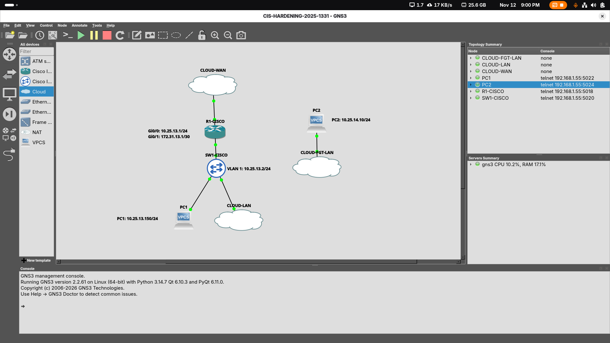
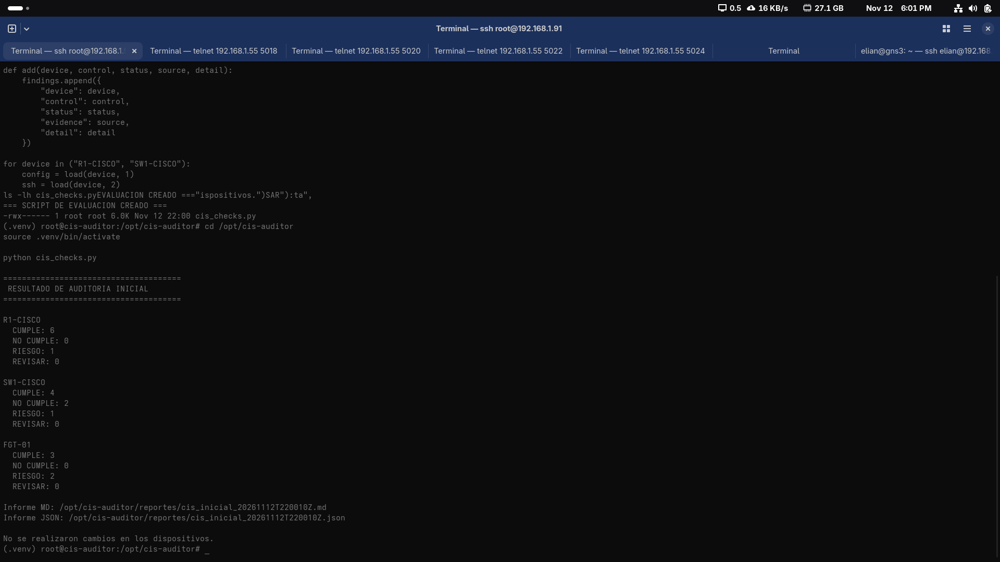
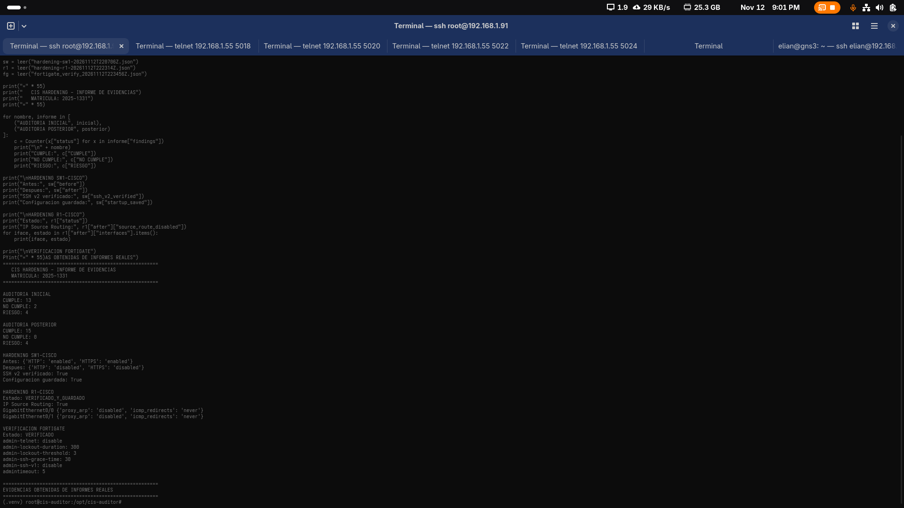
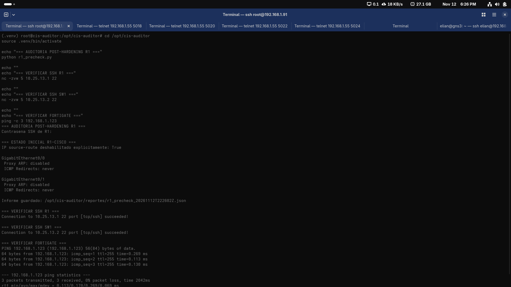
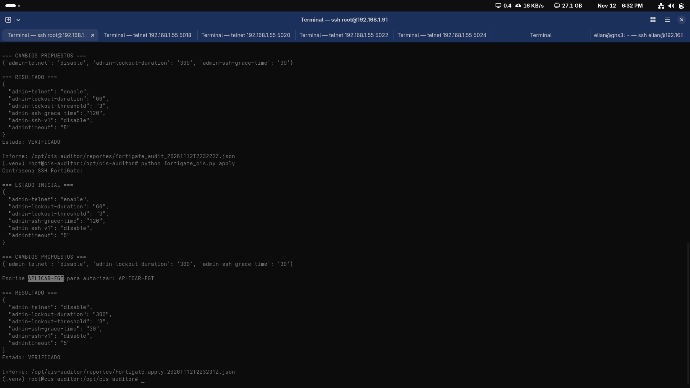
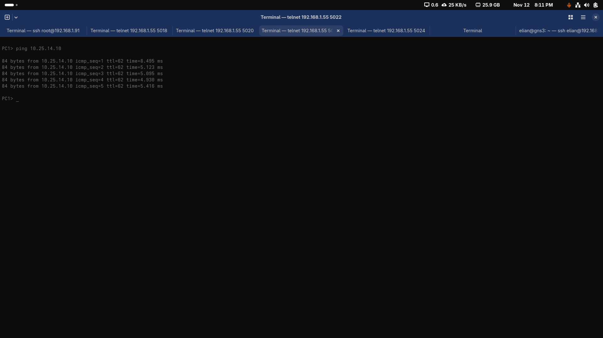
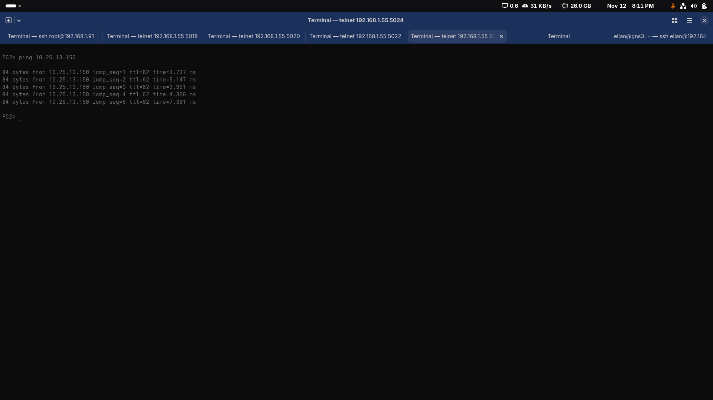
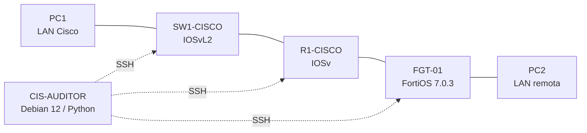

# CIS Hardening — Router, Switch y Firewall

## Video demostrativo

**[▶ Ver demostración completa de CIS Hardening en YouTube](https://youtu.be/o8A4TlShpM0)**

**Enlace directo:** https://youtu.be/o8A4TlShpM0

---

**Estudiante:** Elian Sterling Severino Mejía  
**Matrícula:** 2025-1331  
**Asignatura:** Seguridad de Redes  
**Fecha del laboratorio:** 12 de noviembre de 2026

## Galería visual del laboratorio

  

<em>Topología de GNS3 con direccionamiento. El firewall FGT-01 se ejecuta como VM independiente en Proxmox y se conecta mediante las redes virtuales.</em>

### Auditoría de seguridad y hardening

<table>
  <tr>
    <td width="50%" align="center">
      
       <strong>Auditoría inicial</strong> 13 CUMPLE · 2 NO CUMPLE · 4 RIESGO
    </td>
    <td width="50%" align="center">
      
       <strong>Resultados posteriores</strong> 15 CUMPLE · 0 NO CUMPLE · 4 RIESGO en la evaluación de 19 controles
    </td>
  </tr>
  <tr>
    <td align="center">
      
       <strong>R1-CISCO</strong> Verificación de medidas aplicadas
    </td>
    <td align="center">
      
       <strong>FGT-01</strong> Aplicación y comprobación de controles
    </td>
  </tr>
  <tr>
    <td align="center">
      
       <strong>Conectividad PC1 → PC2</strong> Prueba posterior al hardening
    </td>
    <td align="center">
      
       <strong>Conectividad PC2 → PC1</strong> Prueba posterior al hardening
    </td>
  </tr>
</table>

<a href="evidencias/INDICE.md"><strong>Ver las 21 evidencias y su descripción</strong></a>

---

## Propósito

Implementar y evaluar medidas de endurecimiento de seguridad en una infraestructura virtual de **GNS3 + Proxmox** integrada por un router Cisco IOSv, un switch Cisco IOSvL2 y un firewall FortiGate.

La metodología incluye recopilación de configuraciones por SSH, auditoría inicial de controles seleccionados, aplicación automatizada bajo autorización, verificación posterior e informes comparativos.

## Topología

| Componente | Gestión en el laboratorio |
|---|---|
| R1-CISCO | `10.25.13.1` |
| SW1-CISCO | `10.25.13.2` |
| FGT-01 | `192.168.1.123` |
| CIS-AUDITOR (CT 180) | `10.25.13.220` |
| LAN Cisco | `10.25.13.0/24` |
| Enlace R1 ↔ FGT | `172.31.13.0/30` |
| LAN remota | `10.25.14.0/24` |

## Validación de controles CIS

El laboratorio incluye ahora un **evaluador propio de 7 controles seleccionados con referencias CIS identificadas**, además del evaluador original de 19 verificaciones de configuración. No representan una certificación CIS-CAT.

- **Cisco:** referencia histórica CIS Cisco IOS Benchmark v2.2 (2007), controles 1.2.2.5, 1.3.1.2 y 2.3.3.2; no se afirma compatibilidad certificada con IOSv 15.9.
- **FortiGate:** CIS Fortigate 7.0.x, controles 2.2.2, 2.4.4 y 2.4.5; el bloqueo administrativo objetivo es **900 segundos**. La auditoría posterior del **13 de noviembre de 2026** confirmó umbral de **3 intentos** y bloqueo de **900 segundos**; este control ahora **CUMPLE**.
- **Excepción pendiente:** HTTP en `port1` impide declarar conforme el control 2.4.5. Se mantiene por las limitaciones de la instancia de evaluación, exclusivamente en red aislada.

**Programa principal:** `scripts/cis_centro.py` ofrece los modos `audit` (sin cambios), `apply --allow-changes` (autorización explícita), `verify` (solo lectura) y `report` (informe offline). Cada función reutiliza los scripts y controles previamente documentados.

- [Matriz de controles CIS con identificación, justificaciones y excepciones](docs/justificacion-hardening.md)
- [Guía de ejecución del auditor integrado](docs/operacion-auditor.md)
- [Lista de requisitos del profesor y pendientes antes del video](docs/revision-requisitos.md)
- [Topología y direccionamiento basado en la matrícula](docs/topologia-y-direccionamiento.md)

## Validación integrada del 13 de noviembre de 2026

Se ejecutó exitosamente `cis_centro.py audit` seguido de `cis_centro.py apply --allow-changes`. El equipo FortiGate pasó de `admin-lockout-duration 300` a **900**, y la auditoría posterior de solo lectura corroboró el cambio. R1 y SW1 no requirieron modificaciones adicionales.

| Evaluador | Resultado posterior |
|---|---|
| 19 verificaciones locales | **15 CUMPLE, 0 NO CUMPLE, 4 RIESGO** |
| 7 controles con referencias CIS | **6 CUMPLE, 1 NO CUMPLE** |

**Excepción pendiente:** CIS Fortigate 2.4.5, HTTP de administración en `port1`. No se presenta el laboratorio como completamente conforme. [Resumen de ejecución verificada](reportes/validacion-integrada-20261113.md).

## Resultados documentados

El evaluador inicial consideró **19 comprobaciones seleccionadas**: **13 CUMPLE, 2 NO CUMPLE y 4 RIESGO**. Después del hardening de SW1, sobre esas mismas 19 comprobaciones se obtuvo **15 CUMPLE, 0 NO CUMPLE y 4 RIESGO**.

Los cambios de R1 y FGT-01 se verificaron en reportes adicionales, independientes de esa matriz de 19 comprobaciones.

| Equipo | Cambios automatizados |
|---|---|
| SW1-CISCO | Desactivación de HTTP y HTTPS administrativos; SSH v2 conservado |
| R1-CISCO | Desactivación de Proxy ARP e ICMP Redirects en Gi0/0 y Gi0/1; desactivación explícita de IP Source Routing |
| FGT-01 | Telnet administrativo deshabilitado; bloqueo administrativo de 60 a 300 s en la primera etapa y a **900 s** tras correlación CIS; tiempo de autenticación SSH de 120 a 30 s |

Las verificaciones posteriores confirmaron que los tres puertos SSH seguían accesibles. También se validó la comunicación entre PC1 y PC2 tras los cambios.

## Estructura

- `scripts/`: recopilación, evaluación, aplicación y verificación de controles
- `reportes/`: informes generados en el laboratorio, previa revisión y sanitización
- `docs/`: topología, metodología, controles y limitaciones
  - [Topología y direccionamiento según matrícula](docs/topologia-y-direccionamiento.md)
  - [Justificación técnica, referencias CIS y limitaciones](docs/justificacion-hardening.md)
- `evidencias/`: capturas de las pruebas y del proceso
- `configuraciones/`: extractos sanitizados de las configuraciones finales de R1, SW1 y FGT-01 (no son respaldos restaurables)
- `.gitignore`: exclusión de respaldos, credenciales y archivos sensibles

## Evidencias y configuraciones finales

- [Galería de 21 capturas e índice de evidencias](evidencias/INDICE.md)
- [R1-CISCO — running-config ampliado y censurado](configuraciones/R1-CISCO-running-config-CENSURADO.txt)
- [SW1-CISCO — running-config ampliado y censurado](configuraciones/SW1-CISCO-running-config-CENSURADO.txt)
- [R1-CISCO — extracto breve sanitizado](configuraciones/R1-CISCO-running-config-sanitizado.txt)
- [SW1-CISCO — extracto breve sanitizado](configuraciones/SW1-CISCO-running-config-sanitizado.txt)
- [FGT-01 — extracto sanitizado](configuraciones/FGT-01-config-sanitizada.txt)

Los tres extractos se generaron tras una auditoría de solo lectura de **15/15 evidencias** (cinco por dispositivo). Los respaldos originales permanecen privados en CIS-AUDITOR. La sanitización se basa en una selección cerrada de comandos y campos autorizados.

## Reproducibilidad

El auditor se ejecutó en Debian 12 con Python, Netmiko y Paramiko. Los dispositivos Cisco del laboratorio requieren compatibilidad con algoritmos SSH heredados. Las direcciones, versiones y usuarios de los scripts corresponden **exclusivamente al entorno de demostración** y deben adaptarse antes de ejecutarlos en otra infraestructura.

**No ejecutar los scripts de aplicación en producción sin revisión, respaldos, autorización y plan de reversión.**

## Alcance y límites

Este proyecto documenta **controles seleccionados y prácticas de hardening**, no una auditoría integral ni una certificación oficial de cumplimiento CIS. La nueva matriz identifica referencias de los CIS Benchmarks consultados y explica sus límites: la edición histórica de Cisco no certifica compatibilidad con IOSv 15.9 y el control FortiGate 2.4.5 conserva una excepción real.

Se mantienen riesgos residuales: algoritmos SSH heredados en IOSv; FortiOS 7.0.3 de evaluación; y administración HTTP habilitada en la interfaz de gestión de FortiGate por restricciones de este laboratorio.

Los archivos originales `backups/`, contraseñas, archivos `.env`, claves SSH y otras configuraciones no sanitizadas **no se publican**.
