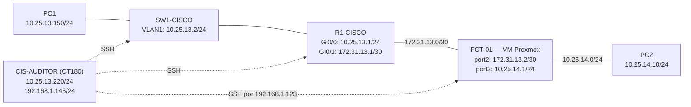

# Topología y direccionamiento basado en la matrícula

**Estudiante:** Elian Sterling Severino Mejía  
**Matrícula:** 2025-1331  
**Alcance:** infraestructura única en Proxmox y GNS3.

## 1. Propósito de la arquitectura

Demostrar la comunicación controlada entre dos redes y la administración segura de un router Cisco IOSv, un switch Cisco IOSvL2 y un FortiGate. Las configuraciones se auditan y endurecen desde un contenedor Debian de solo acceso autorizado.

## 2. Diagrama lógico

**Aclaración:** el FortiGate no es un nodo integrado en el proyecto GNS3; se ejecuta como una VM independiente en Proxmox. Las nubes GNS3 conectan las redes virtuales con ese dispositivo.

## 3. Plan de direccionamiento

| Segmento o equipo | Dirección / red | Función |
|---|---|---|
| LAN Cisco | `10.25.13.0/24` | Segmento de PC1, SW1, R1 y CIS-AUDITOR |
| R1-CISCO Gi0/0 | `10.25.13.1/24` | Puerta de enlace de PC1 |
| SW1-CISCO VLAN 1 | `10.25.13.2/24` | Gestión del switch |
| PC1 | `10.25.13.150/24` | Cliente de la primera LAN |
| CIS-AUDITOR | `10.25.13.220/24` | Escaneo por SSH |
| Enlace R1 ↔ FGT | `172.31.13.0/30` | Tránsito punto a punto |
| R1-CISCO Gi0/1 | `172.31.13.1/30` | Extremo Cisco del enlace |
| FortiGate port2 | `172.31.13.2/30` | Extremo firewall del enlace |
| LAN remota | `10.25.14.0/24` | Segmento de PC2 |
| FortiGate port3 | `10.25.14.1/24` | Puerta de enlace de PC2 |
| PC2 | `10.25.14.10/24` | Cliente de la LAN remota |
| FortiGate port1 | `192.168.1.123/24` | Gestión de laboratorio |

## 4. Relación con matrícula 2025-1331

Para hacer explícita la relación exigida por la asignación, se documenta el siguiente criterio de identificación de las redes ya utilizadas:

- `25`: dos últimos dígitos del año de matrícula `2025`.
- `13` y `31`: dos pares del identificador `1331`.
- `10.25.13.0/24`: red base que combina `25` y `13`.
- `172.31.13.0/30`: red de tránsito que utiliza `31` y `13`.
- `10.25.14.0/24`: segunda LAN consecutiva respecto de la red base, para separar el tráfico mediante enrutamiento y firewall.

Este es el **criterio de asociación documentado para la infraestructura**. Si la asignatura exige una fórmula específica de cálculo de IP a partir de la matrícula, debe verificarse que este criterio coincida con esa fórmula; el enunciado proporcionado no define una.

## 5. Prueba de conectividad

Los pings de PC1 a PC2 y de PC2 a PC1 se verificaron antes y después del hardening. Las políticas FortiGate permiten el servicio `PING` en ambos sentidos. Las evidencias visuales se encuentran en [el índice de capturas](../evidencias/INDICE.md).

Los puertos SSH de R1, SW1 y FortiGate permanecieron accesibles tras las medidas aplicadas. HTTP administrativo en el FortiGate sigue disponible en `port1` por razones específicas del laboratorio y debe permanecer aislado.
